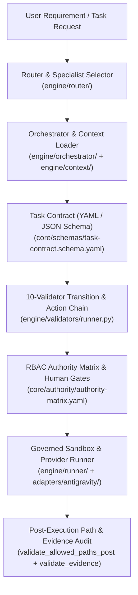

# AI Engineering Harness — Deterministic Agent Governance & Execution Framework


**AI Engineering Harness** is a deterministic agent governance, orchestration, and validation framework written in Python (`>=3.11`). It enforces structured software engineering lifecycles (`discovery -> architecture -> implementation -> verification`), strict Role-Based Access Control (RBAC) via an **Authority Matrix**, and mandatory human approval gates via JSON-Schema **Task Contracts**.

> **Independent Project Notice:** This project is an independent open-source governance framework developed by **Yhoanes Ander Mendoza Rodriguez**. Its adapter module (`adapters/antigravity/`) integrates with the Google Antigravity IDE/CLI workflow specification as a third-party extension and is not an official Google product.

---

## 🏗️ System Architecture



---

## ⚡ Core Verified Modules

| Module | Path | Implemented Responsibilities |
| :--- | :--- | :--- |
| **Orchestrator & Router** | `engine/orchestrator/`, `engine/router/` | Routes tasks to 18 specialized agent profiles (`core/specialists/`) and 16 structured workflows (`core/workflows/`), assembles tiered context bundles, and enforces read-only restrictions (`NO_IMPLEMENTATION`, `NO_STATE_CHANGES`) during discovery/discussion. |
| **Task Contracts & Schemas** | `core/schemas/` | Defines JSON Schema specifications for standard and lightweight Task Contracts (`task-contract.schema.yaml`, `task-contract-light.schema.yaml`), approval records, deviations, and state transitions (`state-machine.yaml`). |
| **Deterministic Validator Chain** | `engine/validators/` | Executes 10 composable validators (`validate_task_contract`, `validate_transition`, `validate_approval_gate`, `validate_acceptance_gate`, `validate_allowed_paths_pre`, `validate_allowed_paths_post`, `validate_authority`, `validate_preconditions`, `validate_evidence`, `validate_deviation`). |
| **RBAC Authority Matrix** | `engine/governance/authority.py`, `core/authority/authority-matrix.yaml` | Enforces `DENY_ALL`, `ALLOW_LIST`, and `UNRESTRICTED` permissions per specialist across `read_paths`, `modify_paths`, `terminal_commands`, and `network_allowed`. |
| **Governed Sandbox & Adapters** | `engine/runner/`, `adapters/antigravity/` | Provides git-worktree/baseline verification, subprocess timeout and scope enforcement, and headless CLI execution adapters (`autonomous_runner.py`, `cli_executor.py`). |
| **Distribution & Export Security** | `engine/distribution/`, `engine/export/` | Builds portable runtime distributions (`distribution-manifest.yaml`) with automated secret and machine-path scanning (`engine/export/security.py`), SHA-256 manifest checksums, and symlink rejection. |

---

## Native Antigravity Integration (v1.2.0+)

To use the AI Engineering Harness directly in Google Antigravity:
1. Open the repository root as a workspace.
2. Use the `/advisor`, `/new-project`, and `/evolve-harness` slash commands.
3. **No credentials** are required within the repository.
4. Advisors operate strictly in **read-only mode**. Modifications require a Task Contract and human approval. See [docs/antigravity.md](docs/antigravity.md) for details.

## Quick Start

On Windows, install Python 3.11 or newer, extract the complete Harness, and
double-click `INSTALAR.cmd`. The launcher keeps the result visible and reports
`STATUS: READY` when installation succeeds.

Advanced and cross-platform instructions are available in `install/README.md` and
`docs/installation.md`.

## Advisor
The General Advisor is your read-only guidance entry point. It can explain workflows,
summarize capabilities, and guide you based on your current project's state. Access it
programmatically or through the CLI (`python -m engine.advisor`). It does not provide a
standalone chat interface; a conversational host must connect through an adapter and
executor integration.

## Projects
All user projects live strictly inside the `projects/` directory. They remain separate from the harness internals. Creating a project requires a governed filesystem operation (an authorized Task Contract).

## Specialists and Workflows
The Harness uses 18 specialized agents (e.g., `software-architect`, `backend-engineer`, `security-engineer`, `qa-engineer`) and 16 predefined workflows (e.g., `analyze-requirement`, `design-solution`, `implement-task`, `security-review`).
Ask the Advisor to discover them dynamically!

## Governance
Actions that modify your workspace are gated by Task Contracts (inside your project's `.harness-internal/tasks/` folder) and validated against the Authority Matrix. See `docs/governance.md`.

## Development vs Portable Distribution
This package is a clean, portable distribution. When you upgrade, your `projects/` folder will remain intact.

## Running Tests
The full test suite requires Python 3.11+ and Git on `PATH`. It does not require a
global Git `user.name` or `user.email`; tests that create temporary repositories use
an isolated test identity.

On Windows, install the development dependencies and run the suite with:

```powershell
.\.venv\Scripts\python.exe -m pip install ".[dev]"
.\.venv\Scripts\python.exe -m pytest -p no:cacheprovider
```

## Documentation
See the `docs/` folder for deeper architectural understanding:
- `docs/getting-started.md`
- `docs/advisor-guide.md`
- `docs/project-lifecycle.md`
- `docs/governance.md`
- `docs/distribution.md`

## License & Third-Party Dependencies
- **Project License:** Released under the [MIT License](LICENSE).
- **Runtime Dependencies:** `PyYAML >= 6.0` (MIT License) and `jsonschema >= 4.0` (MIT License).
- **Development Dependencies:** `pytest >= 8.0` (MIT License), `pytest-cov >= 5.0` (MIT License), `ruff >= 0.5` (MIT License).

## Version
Check the `VERSION` file for the current release (`1.13.7`).
